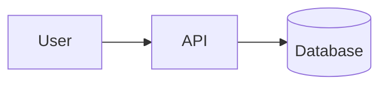

# Architecture: <name>

**Status:** see `status.md`  ·  **Spec:** `docs/specs/<name>.md`

## 1. Context & scope

## 2. Components & responsibilities
| Component | Responsibility | Talks to |
|---|---|---|
## 3. Data model & storage
## 4. API design principles
(versioning, pagination, idempotency keys, error format)
## 5. Cross-cutting concerns
authn/authz · secrets · logging · metrics · tracing · config
## 6. Reliability
failure modes · timeouts/retries · backups · scaling assumptions
## 7. Security
Link: `threat-model.md`. Dependency & supply-chain stance.
## 8. Testing strategy
| Level | What | Tooling | Runs in CI |
|---|---|---|---|
| Unit | | | yes |
| Integration | | | yes |
| End-to-end | | | |
## 9. Deployment & environments
## 10. Risks, trade-offs, non-decisions
## Review responses
(Architect replies to each finding: Accepted / Rejected + reasoning)
