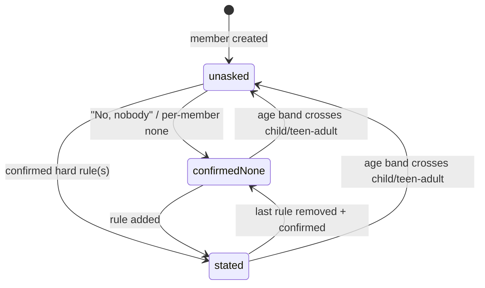
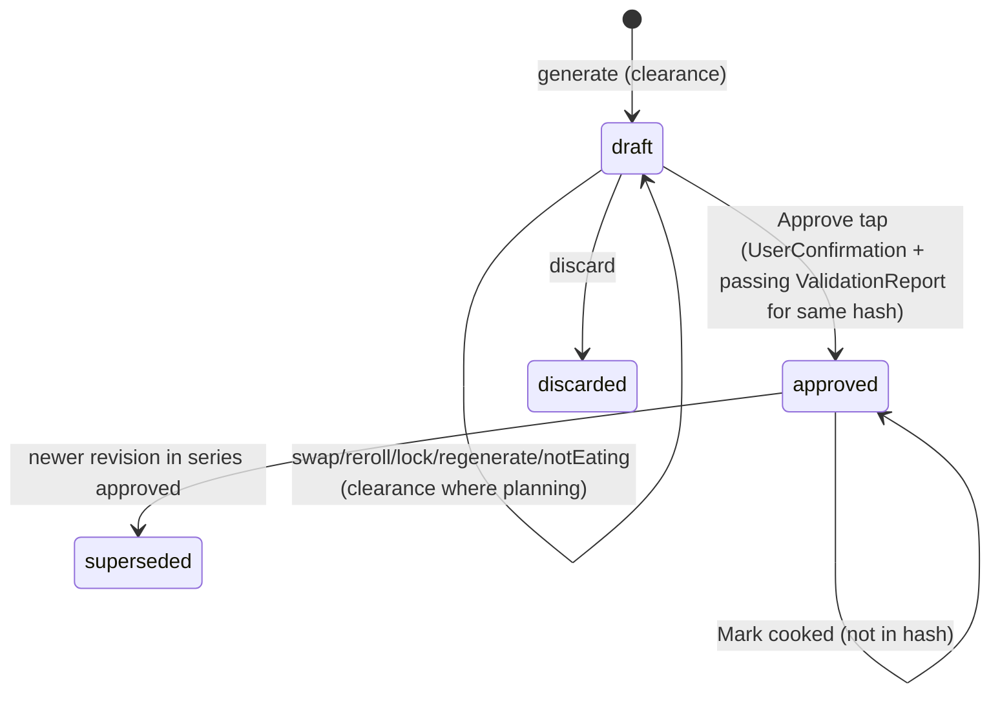

# OffMyPlate v1: Architecture plan (adopt mode)

**Status:** ACCEPTED FOR BUILD. The owner waived plan approval ("go ahead and build it", autonomy 3), so the recommendations in §0.4 apply as defaults unless the owner objects. · **Date:** 2026-10-12
**Inputs:** spec `docs/specs/offmyplate-v1.md` (approved), owner's `docs/technical-specification.md` (tech §n), `docs/product-concept.md`, `docs/STATUS.md`. UX: `docs/design/` (flows F1–F12, screens S-xx, copy C-xxx).
**Companion files:** work breakdown `docs/architecture/tasks.md` · decisions `docs/adr/0001…0015`.

---

## 0. Plain-language summary (about 5 minutes)

### 0.1 What will be built
- An **iPhone/iPad app written in Swift/SwiftUI** for iOS 18. It works fully offline, has no servers, no accounts and no AI model.
- The **"brain"** (the safety gate, the meal planner, approvals, pantry and shopping arithmetic, learning, and the text and voice parsers) is a separate pure-Swift package called **Core**. It has no Apple-only code, so it builds on Linux as well as on your Mac. A Linux GitHub Actions job tests it on every push, and so does the macOS job.
- The **screens, database (SwiftData), microphone and Share Extension** live in an **Apple package** and a small Xcode project. You and a macOS GitHub Actions runner build those.
- **Safety by construction:**
  - The planner can't be called without a "safety clearance" that only the safety gate issues.
  - A second, independently written checker re-checks every plan before you see it and again when you tap Approve.
  - A dedicated test suite that can't be skipped tries every allergy and restriction against every recipe on every build.
- **Approval:** a plan is a draft until you tap Approve. Approval stores a fingerprint (hash) of the plan, so any later change makes it "not approved" again. Voice and the Share Extension physically can't approve: they don't link the approval code.
- **Content:** 30 original Indian home-cooking recipes and about 150 ingredients, kept as readable JSON files. Tests check that every recipe's allergens follow from its ingredients and that doubtful ingredients are tagged conservatively. You (or someone you nominate) sign off each recipe before beta. A generated review sheet makes that easy.
- **Notes import:** the Share Extension parses the note and you review it. It then drops a small file in a shared folder, and the app merges it the next time it opens. The extension never touches the database.

### 0.2 Your choices kept as given (ADR "given by owner")
Native Swift/SwiftUI universal app, iOS/iPadOS 18 (0001) · on-device only, no backend, no hosted LLM, non-AI fallbacks (0002) · SwiftData (0003) · your module names `OMPDomain/OMPData/OMPRecipes/OMPCapture/OMPUI` and an Apple-framework-free domain (0004, 0005) · safety gate and separate hard-rule checker (0007) · draft/approved/superseded/discarded plus content hash (0008) · deterministic planner pipeline (0009) · bundled recipe library with structured allergen tags (0010) · Share Extension with App Group (0011) · Speech plus command-grammar voice fallback (0012) · Facts with provenance, where inference never touches safety (0013) · no third-party analytics (0014) · CloudKit deferred, model kept sync-ready (0015).

### 0.3 Risks found
1. **Allergen data quality is the real safety risk.** The code can only be as safe as the tags. Mitigations: conservative tagging, a two-sided recipe/ingredient check, human sign-off, and a release gate (G1/G4).
2. **Thirty recipes vs strict households.** A Jain plus nut-allergy household may get empty or repeated slots. The app will say so honestly rather than break a rule (G5).
3. **Build verification.** This cloud session has no Swift, and download.swift.org is **blocked by the network policy** (HTTP 403, checked today). So nothing depends on a local toolchain. Every task is verified by GitHub Actions (a Linux job for Core, a macOS job for everything) and on your Mac. A local toolchain is a nice-to-have that T01 tries once.
4. **Apple-only parts** (screens, database, Share Extension) can't be verified in the cloud. They depend on the macOS CI runner or your Mac.
5. **Offline speech recognition** for English (India) depends on the device. Manual entry always remains as the fallback.

### 0.4 What I recommend changing (you decide; defaults apply under autonomy 3)
- **R1 (safety, recommended).** If someone adds an allergy *after* a plan is approved, the spec only re-checks open drafts. The approved plan could still show (and put on the shopping list) a meal that is now unsafe. **Default:** re-check the approved plan too. Flag unsafe meals, keep them off the shopping list and out of "Mark cooked", and offer a fixed draft for approval.
- **R2 (optional).** Allow `download.swift.org` in this environment's network settings, so agents could also run core tests locally (faster feedback). **Default:** CI-only verification.
- **R3.** The GitHub Actions jobs (Linux and macOS) are added in **T01**, because they are now the main way agents verify work. Note that macOS minutes cost 10× on private repos. **Default:** add them in T01. You may need to enable Actions on the repo.
- **R4.** Confirm the restriction definitions, which are part of the G1 sign-off:
  - "Vegetarian" also excludes **egg**, following the Indian convention.
  - "Jain" excludes root vegetables, onion, garlic **and mushrooms**.
  - Typing "nuts" selects **both peanuts and tree nuts**.
  - Hing (asafoetida) counts as **wheat/gluten**.

  **Default:** as listed.
- **R5 (structure).** Your tech §4.1 puts the Notes parser in `OMPCapture` behind `OMPIntelligence`. I put the rule-based parsers in `OMPDomain`, so they're testable on Linux, and I don't build `OMPIntelligence` in v1. I also add `OMPServices` (the use cases, your §4 "Application Services") and `OMPFeatures` (the screens), and make the safety checker its own module `OMPSafetyCheck` as tech §6.2 asks.
- **R6.** Give me your **bundle ID prefix, App Group ID, Apple Developer Team and Xcode version**. **Default:** placeholders `app.offmyplate.OffMyPlate` and `group.app.offmyplate`; team set locally in a git-ignored file; Xcode 26 (Swift 6.2).
- **R7 (small assumptions).** Children with a lunchbox aren't counted at the family lunch on their school days. Lines already ticked in a Note start deselected on the import review screen.
- **R8 (decided, UX U10).** Each plan covers **7 days from its start date**. The first plan starts **today**, and each next plan starts the day after the previous one ends. Approval never moves the dates (moving them would change the fingerprint). "Week starts Monday" (A8) is used only for weekly counting (prompt caps, learning weeks).
- **R9 (decided, UX C-137).** Voice runs **on-device only** (`requiresOnDeviceRecognition`). Devices without on-device English get the "Voice isn't available" screen and type instead. This keeps the "no network requests" promise (AC-13.2), and the purpose string says "Speech stays on this device."

---

## 1. Plan validation (owner's tech spec vs approved spec)

| # | Sev | Finding | Resolution |
|---|---|---|---|
| V1 | [MAJOR] | Hard-rule edits re-validate only open drafts (AC-3.5). An approved plan can keep an unsafe meal. | R1: `SafetyService.hardRulesChanged` re-validates the active approved plan, marks violating meals `blockedBySafety`, removes them from shopping derivation and Mark cooked, and proposes a draft revision. |
| V2 | [MAJOR] | Tech §4.1: Notes parsing in `OMPCapture -> OMPIntelligence` would be Apple- or model-bound. | Parsers go in `OMPDomain`; `OMPIntelligence` is deferred (ADR 0002, 0004). |
| V3 | [MAJOR] | Tech §8.1 "shared App Group store": two processes on one SwiftData store risks locking and migration races. | Inbox files in the App Group; the store stays private (ADR 0011). |
| V4 | [MAJOR] | No Linux toolchain reachable (download.swift.org returns 403). | CI is the verification of record (§9); a local toolchain is optional; R2. |
| V5 | [MAJOR] | Restriction semantics (vegetarian/Jain/"nuts"/hing) are product-safety decisions not stated in the sources. | R4; encoded in `catalog.json`, signed off with G1. |
| V6 | [MINOR] | Tech §5.1 has both `Member.allergies` and `Rule`, which is two sources of truth. | Hard restrictions are stored only as `Rule(kind: .hard)`; the member view derives from them. |
| V7 | [MINOR] | Tech §6.1 step 5 (local search/ILP) is for nutrition, which is deferred. | Greedy plus seeded tie-break (ADR 0009). |
| V8 | [MINOR] | Tech §4 "Application Services" has no module. | `OMPServices` (portable, Linux-tested). |
| V9 | [MINOR] | The tech spec has no project-file strategy. | XcodeGen (ADR 0006). |
| V10 | [QUESTION] | Bundle/App Group IDs, team, Xcode version. | R6 defaults. |
| V11 | [MINOR] | `SpeechAnalyzer` (tech §8.3) is iOS 26+. | v1 uses `SFSpeechRecognizer`, on-device only (ADR 0012, R9). |
| V12 | [MINOR] | Spec A8 conflict: "week starts Monday" vs "next 7 days from approval" (UX U10). | R8: 7 days from the plan's start date (first = today); Monday only for weekly counters. |

Everything else in the owner's plan meets the spec's ACs and NFRs as written.

---

## 2. Repository and module layout

```
off-my-plate/
├─ Packages/
│  ├─ Core/                         # Linux + Apple, Foundation only, zero deps (ADR 0005)
│  │  ├─ Package.swift
│  │  ├─ Sources/OMPDomain/         # Model/ Units/ Safety/ Planner/ Plan/ Pantry/ Shopping/
│  │  │                             # Learning/ Prompts/ Parsing/ Inbox/ Util/(SHA256, SplitMix64, LocalDate)
│  │  ├─ Sources/OMPSafetyCheck/    # independent PlanValidator (ADR 0007)
│  │  ├─ Sources/OMPRecipes/        # loader + Resources/seed/{catalog,ingredients,recipes}.json
│  │  ├─ Sources/OMPServices/       # use cases, repository protocols, InMemory repos
│  │  ├─ Sources/seed-review-sheet/ # executable: markdown sign-off sheet
│  │  └─ Tests/{OMPDomainTests,OMPSafetyCheckTests,OMPRecipesTests,OMPServicesTests,OMPSafetySuiteTests}
│  └─ Apple/                        # iOS 18 / macOS 15; depends on ../Core by path
│     ├─ Package.swift
│     ├─ Sources/{OMPData,OMPCapture,OMPUI,OMPFeatures}
│     └─ Tests/{OMPDataTests,OMPFeaturesTests}
├─ App/
│  ├─ project.yml                   # XcodeGen (ADR 0006); *.xcodeproj git-ignored
│  ├─ .xcodegen-version
│  ├─ Config/{Base.xcconfig, Local.xcconfig.example}   # Local.xcconfig git-ignored (team ID)
│  ├─ OffMyPlate/                   # @main, composition root, Info.plist, entitlements,
│  │                                # Localizable.xcstrings, PrivacyInfo.xcprivacy, Assets
│  ├─ OffMyPlateShare/              # share extension: view controller hosting SwiftUI review
│  └─ OffMyPlateUITests/
├─ scripts/  bootstrap-swift-linux.sh · check-core.sh · lint-core-imports.sh · lint-safety.sh · lint-no-network.sh
├─ .github/workflows/  core-linux.yml · apple-macos.yml
└─ docs/ …
```

**Core `Package.swift` (shape):** products `OMPDomain`, `OMPSafetyCheck`, `OMPRecipes`, `OMPServices`. Targets: `OMPSafetyCheck -> OMPDomain`, `OMPRecipes -> OMPDomain` (resources `.copy("Resources/seed")`), `OMPServices -> OMPDomain, OMPSafetyCheck, OMPRecipes`. `swiftLanguageModes: [.v6]`.
**Apple `Package.swift`:** `.package(path: "../Core")`. `OMPData -> OMPServices`; `OMPCapture -> OMPDomain`; `OMPUI` (none); `OMPFeatures -> OMPUI, OMPServices, OMPCapture`.
**App targets:** `OffMyPlate` links `OMPFeatures, OMPData`. `OffMyPlateShare` links **only** `OMPDomain`, `OMPRecipes` (for the ingredient resolver) and `OMPUI`. Both share App Group `group.app.offmyplate` (R6).
**Why XcodeGen:** an app extension needs a real Xcode project; a generated one avoids `.pbxproj` merge conflicts between parallel agents (ADR 0006).

---

## 3. Data model

### 3.1 Domain value types (`OMPDomain`, all `Sendable`, `Codable`, `Equatable`)
| Type | Key fields |
|---|---|
| `Household` | id, members, rules, settings{snacksEnabled=false, weekStartsOn=.monday}, createdAt/updatedAt |
| `Member` | id, label ("Adult 1"), name?, ageBand? (infant/toddler/child/teen/adult/senior), safetyStatus (unasked/confirmedNone/stated), safetyConfirmedAt?, needsSchoolLunch, schoolDays:Set<Weekday>, portionOverride?, deletedAt? |
| `Rule` | id, kind (.hard only in v1; soft preferences are Facts), scope (.household / .member(id)), restriction: RestrictionID, excludedTags (snapshot at creation), source (.user), createdAt |
| `FoodTag` | peanut, treeNut, milk, egg, wheat, gluten, soy, sesame, mustard, fish, shellfish, beef, pork, poultry, otherMeat, gelatin, rootVegetable, onion, garlic, mushroom |
| `Restriction` (catalog) | id, label key, excludedTags (from `catalog.json`; see R4) |
| `Ingredient` | id, name, synonyms, tags, mayContain, tagStatus (verified/unverified), aisle, defaultUnit, gramsPerMl?, gramsPerPiece?, defaultLocation, fridgeShelfLifeDays? |
| `Recipe` | id, title, region, mealTypes, lunchboxSuitable, servings, prepMin, cookMin, ingredients[{ingredientId, quantity, unit, optional}], steps, declaredTags, provenance, review |
| `MealPlan` | id, seriesId, revision, basedOn?, weekStart: LocalDate, status (draft/approved/superseded/discarded), meals, approval?, contentVersion, createdAt |
| `PlannedMeal` | id, date, slot (breakfast/lunch/dinner/snack/lunchbox), recipeId?, emptyReason?, locked, servings[{memberId, portion, notEating}], reasons[ExplanationReason], cooked: CookRef?, blockedBySafety |
| `PlanApproval` | approver (.thisDevice; G8), approvedAt, contentHash |
| `PantryItem` | id, ingredientId? / freeTextName, quantity, unit, location (fridge/freezer/shelf), purchasedAt?, expiresAt?, lastConfirmedAt, source (manual/voice/notesImport/cookedDeduct/bought) |
| `ShoppingItem` | id, key, ingredientId?, name, quantity?, unit?, aisle, checkedOff, origin (plan/manual/notesImport), group (toBuy/checkYouHave) |
| `CookLog` | id, planId, mealId, recipeId, cookedAt, deductions |
| `Fact` / `LearningEvent` | per ADR 0013 (subject, statement, origin, confidence, status, suppressed, forgottenAt) / (kind, payload, at) |
| `PromptState` | promptId, lastShownAt, dismissedAt, answeredAt |
| `ValidationReport` | planId, contentHash, violations[{mealId, memberId, tag/unverified}] (produced only by `OMPSafetyCheck`) |

### 3.2 Persistence (`OMPData`, ADR 0003)
`SchemaV1` records: `HouseholdRecord`, `MemberRecord`, `RuleRecord`, `MealPlanRecord` (content as `PlanContentDTO v1` JSON blob, plus `status`, `seriesId`, `approval*` columns for querying), `PantryItemRecord`, `ShoppingItemRecord`, `CookLogRecord`, `FactRecord`, `LearningEventRecord`, `PromptStateRecord`, `ProcessedImportRecord`, `CounterRecord`. Mappers are round-trip tested. CloudKit-compatible rules apply (no unique constraints, everything optional or defaulted). Pruning: events and cook logs older than 12 months are deleted at launch (NFR Storage). "Delete all data" = `container.deleteAllData()` + inbox files + `UserDefaults` suite + counters, then onboarding.
The seed library is **not** persisted. It is loaded read-only from the bundle at launch (it is small), and each plan records `contentVersion`.

---

## 4. Safety gate and plan lifecycle

### 4.1 Safety status (per member, G3)

`SafetyGate.evaluate` refuses with `.safetyUnanswered(ids)` if any non-deleted member is `unasked`, or `.reconfirmationDue(ids)` if `now - confirmedAt > 180 days` (the one-tap "Still correct?" refreshes it). The approved plan stays usable while refused (AC-3.3). "Not sure who" rules are scope `.household`.

### 4.2 Plan lifecycle (ADR 0008)

Editing an approved plan creates `draft(revision+1, basedOn: approvedId)`. The approved version stays active (A6). The approval sheet shows `PlanDiff(basedOn, draft)`. Downstream code (shopping list, Mark cooked) reads only `activeApprovedPlan(series)` where `isEffectivelyApproved` (hash matches). Meals with `blockedBySafety` are excluded (R1).

---

## 5. Planner (ADR 0009)

0. **Date range (R8):** `startDate` = today for the first plan, otherwise previous `endDate + 1`; 7 days. Past days of an active plan are shown but are not re-planned.
1. **Gather** from the clearance snapshot, plus the library, pantry snapshot, active Facts, cook log (last 14 days), start date, locked meals, and seed.
2. **Expand** 7 days × breakfast/lunch/dinner (+snack if enabled). Add a lunchbox slot per school day for children with `needsSchoolLunch`. Eaters = members minus `notEating`, and minus that day's lunchbox children for family lunch (R7).
3. **Hard filter** (per slot): the recipe fits the meal type (lunchbox needs `lunchboxSuitable`). For every eater, the excluded tags of that eater's rules plus household rules must be disjoint from the recipe's derived tags ∪ mayContain. If any ingredient is `unverified` and any eater has any hard rule, the recipe is excluded (AC-4.3).
4. **Score** with fixed weights: pantryCoverage +3, expirySoon +2, cuisineAffinity +2×confidence, favourite +1, dislikeRecipe −4, dislikeIngredient −2 per ingredient, timeFit (weekday dinner ≤ 40 min) +1, recentlyCooked (7 days) −2, same-day duplicate main −3.
5. **Select** greedily by date, then slot. Variety rule: no repeat within 3 days, relaxed only if no candidate remains (reason `.repeatedFewSafeOptions`). With no candidate at all, the meal is empty with `.noSafeRecipe` (AC-4.4). Ties go through the seeded SplitMix64, then recipe id.
6. **Personalise**: portion by age band (adult/teen/senior 1.0, child 0.6, toddler/infant 0.4), overridable.
7. **Explain** with the top two positive components as `ExplanationReason`s (the UI renders the template text).

Entry points (all take `SafetyClearance`): `generateWeek`, `regenerate(keepingLocked:)`, `reroll(meal, reason)` (excludes the current recipe), `alternatives(meal, limit: 3)`. `OMPServices` then runs `PlanValidator`; a failing plan is never returned (AC-4.2). That would be a bug, so it is logged as a programmer error and the offending meals are emptied.

## 6. Pantry and shopping arithmetic
- **Units:** mass g/kg, volume ml/l/tsp(5)/tbsp(15)/cup(240), count piece/dozen. Cross-dimension conversion uses the ingredient's `gramsPerMl`/`gramsPerPiece`. Non-convertible quantities stay separate lines. "Pinch"/"to taste" are non-quantified and never on the list.
- **Requirements** = Σ over meals of the effectively-approved plan (date ≥ today, not cooked, not blocked) of qty × Σportion / recipe.servings.
- **Need** = requirement − usable pantry (resolved, not expired, confident). Pantry that covers the need but has low confidence moves the item to **Check you have** (AC-10.4). Confidence: fridge items are confident for 7 days after `lastConfirmedAt`, shelf and freezer items for 60.
- **List merge** on re-derivation: plan items are recomputed by key; manual and imported items are kept; `checkedOff` is kept when key and quantity are unchanged (AC-10.5). "Bought everything" adds checked items to the pantry at the ingredient's default location.
- **Mark cooked** (approved only): deduct per ingredient from pantry items with the earliest expiry first, clamped at 0, then write the CookLog and a learning event.

## 7. Learning and prompts
`FactLearner` and `PromptScheduler` are pure (ADR 0013). Prompt rules: one visible at a time; non-safety prompts at most 3 per ISO week; dismissed prompts cool down for 14 days; reflect-back at most 1 per week; safety prompts are exempt and come first. The lunchbox prompt is triggered by first opening a lunch slot when there are children (AC-7.1–7.4).

## 8. Parsers and Share Extension handoff
- `ShoppingTextParser` (Notes): splits lines and strips bullets/checkboxes (`-`, `*`, `•`, `☐`, `☑`, `✓`, `- [ ]`, `- [x]`). Supported shapes: `2 kg rice`, `rice - 2kg`, `rice 2kg`, `milk x2`, `2 x milk`, `1/2 kg onions`, `a dozen eggs`, `eggs (12)`. Produces `{rawLine, name, qty?, unit?, wasChecked}`.
- `IngredientResolver`: exact synonym -> singularised -> token match -> edit distance ≤ 1 for words of ≥ 5 letters. It returns ranked candidates, never a forced match.
- `SpokenCommandParser` (ADR 0012) and `SafetyTextParser`: keywords/synonyms -> restriction candidates ("nuts" -> peanut + treeNut; "no beef"; "can't have dairy"). Unknown text is returned as `.unmapped(text)` and the UI forces pick-or-remove (AC-2.4).
- Inbox handoff: ADR 0011. The extension flow is share -> parse -> review (edit/remove, destination) -> confirm -> write `Inbox/<id>.json`. The app drains it on `.active`.

## 9. Build environment and verification
**Verification of record is CI, not the cloud session.** T01 adds `.github/workflows/core-linux.yml` (`swift:6.2-noble` container: `swift build`, `swift test`, the safety suite step, and the lints) and `apple-macos.yml` (`macos-15`: XcodeGen, `swift test` for both packages, `xcodebuild test` for the app and UI tests on iPhone and iPad simulators). Both run on every push to `claude/build-v1`. Agents read the results with the GitHub tools (`actions_get`, `get_job_logs`), and a task is integrated only when both jobs are green on its commit. The owner's Mac is used for device checks (T29) and whenever CI is unavailable.
**Local Linux toolchain: optional.** download.swift.org is blocked (proxy 403). `scripts/bootstrap-swift-linux.sh` makes one best-effort attempt (the swift.org tarball, then the Docker Hub `swift` image if a Docker daemon can be started) and exits 0 with a message if both fail. Nothing in the plan depends on it. If it works, agents also run `scripts/check-core.sh` locally before pushing. Swift version: match the owner's Xcode (assumed Xcode 26 -> Swift 6.2; `swift-tools-version: 6.0`).
**Handoffs state what was verified where** (for example "Core tests: CI run #N green; app UI tests: CI run #N green; device checks: not run").

## 10. Testing strategy
| Layer | What | Where it runs |
|---|---|---|
| Domain unit (Swift Testing) | units, gate, planner components, lifecycle, SHA-256 vectors, pantry/shopping, learner, scheduler, parsers (golden fixtures) | **Linux CI** (`core-linux.yml`; locally if a toolchain exists) and macOS CI |
| Safety suite `OMPSafetySuiteTests` (non-skippable) | every restriction × every seed recipe × slot; all restriction pairs; generated households (seeded property tests, 500 cases); filter vs validator agreement; gate-bypass for every entry point | **Linux + macOS**. Its own CI step; lint forbids `.disabled`/`withKnownIssue` in it; CI fails if 0 tests ran |
| Seed validation | references resolve, declaredTags == derived, every ingredient has an aisle and tagStatus, unit conversions defined, ≥8/14/8 recipe split, lunchbox subset non-empty | **Linux** |
| Services (in-memory repos) | onboarding -> gate -> draft -> approve; edit approved -> revision + diff; R1 re-validation; Mark cooked; list derivation; inbox drain idempotency; Delete all | **Linux** |
| Lints | core imports Foundation only; no network APIs anywhere; safety-gate lint; `UserConfirmation(` only in the approval sheet | **Linux** (shell scripts) |
| Persistence integration | SwiftData round trips, on-disk store reopen, `deleteAllData`, pruning, schema-migration plan smoke test | **macOS** (`swift test` in `Packages/Apple` on macOS 15) |
| View models | state per screen (empty/loading/error/unavailable) | **macOS** |
| UI tests (XCUITest) | F1 onboarding incl. safety screen with no skip/back (AC-2.1), approve flow, voice-approve opens sheet only, Notes import via an inbox fixture, airplane-mode equivalent (a network-denying `URLProtocol` in a test build), `performAccessibilityAudit()` per screen at the largest Dynamic Type (AC-15.1–15.3), iPhone and iPad split view | **macOS CI** (iPhone 16 + iPad simulators, iOS 18) |
| Manual device checklist (T29) | real Notes share, on-device speech offline (en-IN), VoiceOver pass, Reduce Motion, cold start < 1.5 s and plan < 2 s on an iPhone 12-class device, Data Protection with a locked device | **Owner's device** before TestFlight |

Determinism makes every planner test a fixed-seed golden test, plus a performance budget test (a week of plans in < 200 ms on CI).

## 11. Cross-cutting concerns and a short threat model
- **Authn/authz:** none. One device, one planner. Approval is "this device" (G8).
- **Secrets/config:** no secrets in v1. Signing team only in the git-ignored `Local.xcconfig`; future CI signing material goes in GitHub secrets. Build configs Debug/Release; no feature flags or remote config (no server); force-update is not needed (no server contract).
- **Privacy:** the data map is spec §6. Data Protection is Complete. No network. Children: label and optional age band only. `PrivacyInfo.xcprivacy` declares no collection. Professional review before App Store (G4, release blocker).
- **Logging:** OSLog with private interpolation; on-device counters only (ADR 0014).

| Asset / boundary | Threat | Mitigation |
|---|---|---|
| Hard rules -> plan | a bug serves an allergen | clearance token, independent validator, safety suite, conservative tags, human sign-off, R1 |
| Approval | non-user path approves | `UserConfirmation` lint, extension not linked, voice -> sheet only, hash check |
| Share Extension input (untrusted text) | huge or malformed input, odd unicode | 64 KB cap, line cap of 500, parser fuzz tests, review before save |
| Inbox files | corrupt or partial | atomic write, schemaVersion, quarantine to `failed/`, idempotent `importId` |
| Local store | device theft | Data Protection Complete; no export in v1 |
| Supply chain | malicious dependency | zero third-party packages; XcodeGen used only at dev time, version pinned |

## 12. Deployment, versioning, rollback
- No hosting. Distribution is via TestFlight to a small beta (A4). Upload is a **human step** (Xcode Organizer) in v1; CI signing and upload are deferred.
- `MARKETING_VERSION` lives in `project.yml`; `CURRENT_PROJECT_VERSION` is bumped per upload.
- Schema changes need a `VersionedSchema` plus a migration test, and are additive only. Rollback = expire the TestFlight build and ship a fixed build. An older build can't open a newer store, so schema changes are batched and tested.

## 12a. What the UI can rely on (UX "things the architect must support")
| # | UX need (flows.md) | Provided by | Task |
|---|---|---|---|
| 1 | Root gate state + "why blocked" | `SafetyGate.evaluate` -> `GateRefusal(.safetyUnanswered([Member]) / .reconfirmationDue([Member]))`; `HouseholdService.gateStatus` observable by the root view | T08, T18, T21 |
| 2 | Revision diff (Was/Now) | `PlanDiff{changes:[{date, slot, kind: swapped/added/emptied/servingsChanged/lockChanged, before: MealSummary?, after: MealSummary?}]}` | T13 |
| 3 | Approved vs pending projections | `PlanService.workingPlan(series)` (Plan tab) and `PlanService.activeApprovedPlan(series)` (List, Mark cooked); `hasPendingChanges` | T18 |
| 4 | Validator result in the UI | `ValidationReport` returned with every draft and from `approve` (`passedForEveryone` or failing slots + members) | T09, T18 |
| 5 | One card now | `PromptScheduler.next(now, state) -> Prompt?` (safety first, caps, cooldowns, lunchbox Yes/No/Not now per U11, one reflect-back per week) | T17 |
| 6 | Speech availability | `SpeechAvailability = .available / .permissionDenied / .notDetermined / .onDeviceUnsupported / .restricted` (on-device only, R9; network state is irrelevant) | T30 |
| 7 | App Group merge + count | `ImportService.drainInbox() -> ImportSummary{itemsAdded, itemsMerged, destination}` for toast C-111 | T19, T26 |
| 8 | Reason strings | `ExplanationReason` enum per score component; UI maps each to C-084 templates in the String Catalog | T11, T23 |
| 9 | On-device counters | `CounterStore` (local only; wiped by Delete all) | T19, T20 |
| 10 | No deep links/notifications/widgets | none created; no URL scheme in `project.yml` | T02 |

## 13. Screens the spec requires (designed in `docs/design/screens.md`; stories -> screens in its §8)
S-01 Who's eating · S-02 Safety question (+ S-02b, gate cover) · S-03 Cuisines · S-04 Making your plan · S-10 Plan week (draft/approved/pending; S-10b blocked) · S-11 Meal detail · S-12 Swap · S-13 Approval diff · S-14 School lunches · S-15 Cooked sheet · S-20 Pantry · S-21 Add/edit item · S-22 Speak to pantry · S-23 Voice unavailable · S-25 Shopping list · S-30 Household · S-31 Add/edit person · S-33 Allergies & must-avoid · S-35 What I've learned · S-36 Fact sheet · S-37 About/privacy/medical/Delete all · S-40 Notes import review (extension). R1 adds a "no longer safe" state to S-10/S-11 (the UX designer should add copy).

## 14. Traceability (user story -> tasks in `tasks.md`)
| US | Tasks |
|---|---|
| US-1 Onboarding | T03, T18, T21, T22 |
| US-2 Safety question | T08, T16, T18, T22, T30 |
| US-3 Gate | T08, T12, T18, T19, T22, T27 |
| US-4 Hard-rule guarantees | T04, T05, T06, T09, T10, T11, T12 |
| US-5 Lifecycle | T13, T16, T18, T23 |
| US-6 Slots/servings | T10, T14, T23 |
| US-7 Lunchbox | T10, T17, T18, T23 |
| US-8 Swap/lock/regenerate | T11, T18, T23 |
| US-9 Pantry | T07, T14, T16, T19, T24, T30 |
| US-10 Shopping | T14, T19, T25 |
| US-11 Notes import | T15, T19, T26 |
| US-12 Learning | T11, T17, T19, T27 |
| US-13 Offline | T01, T02, T28, T30 |
| US-14 Disclaimer | T21, T22, T23, T27 |
| US-15 Accessibility | T21–T27, T28 |
| US-16 Household/data | T19, T20, T27 |

## 15. Trade-offs and deliberately left out
Left out: `OMPIntelligence`, CloudKit, widgets and intents, nutrition, pack-size rounding, staples threshold, Reminders, CI signing/upload, snapshot-test library (accessibility audits are used instead). Trade-offs: a JSON blob for plan content (simplicity over queryability); hand-rolled SHA-256/PRNG (zero dependencies over reuse); greedy planner (simplicity over optimality, revisit with nutrition).

## Review responses
_None yet (round 1)._
