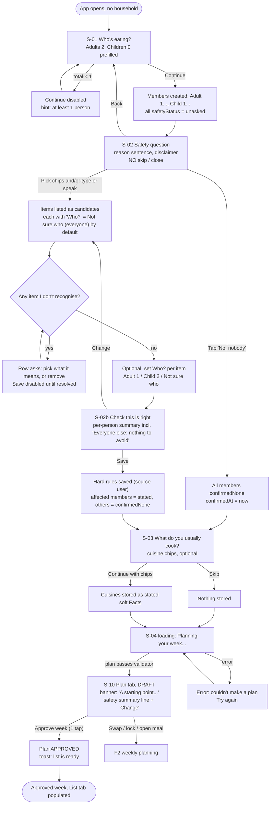
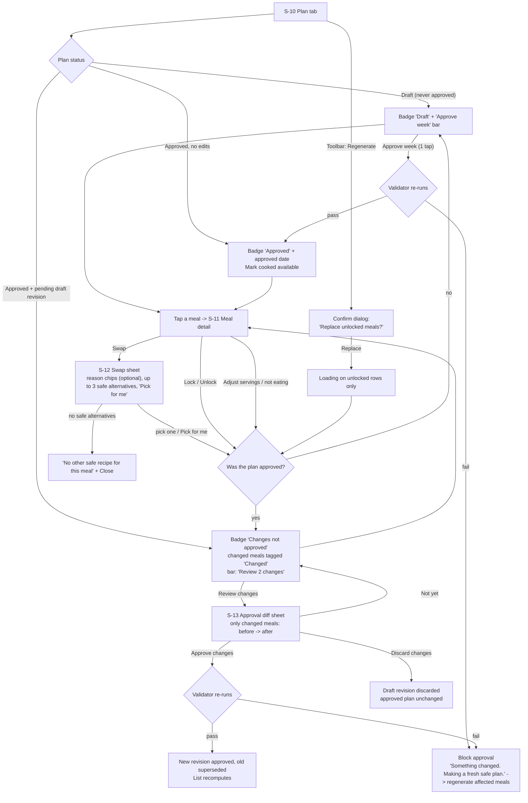
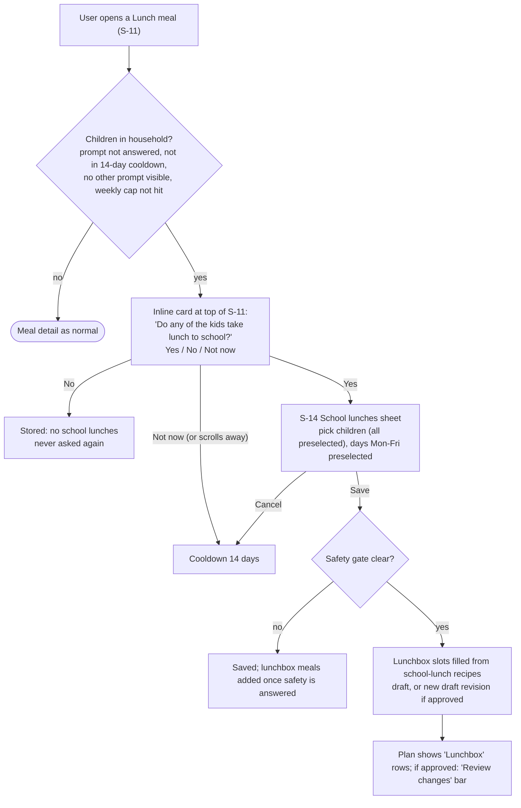
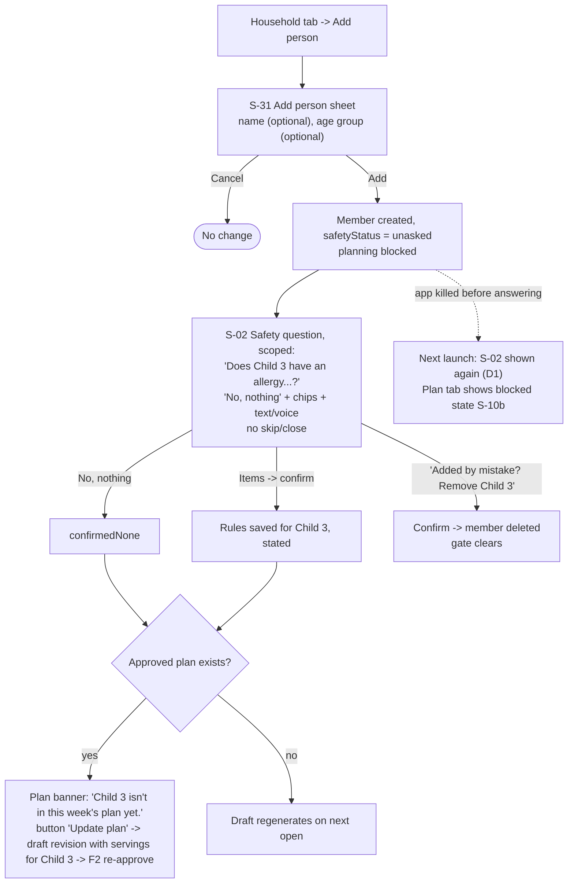
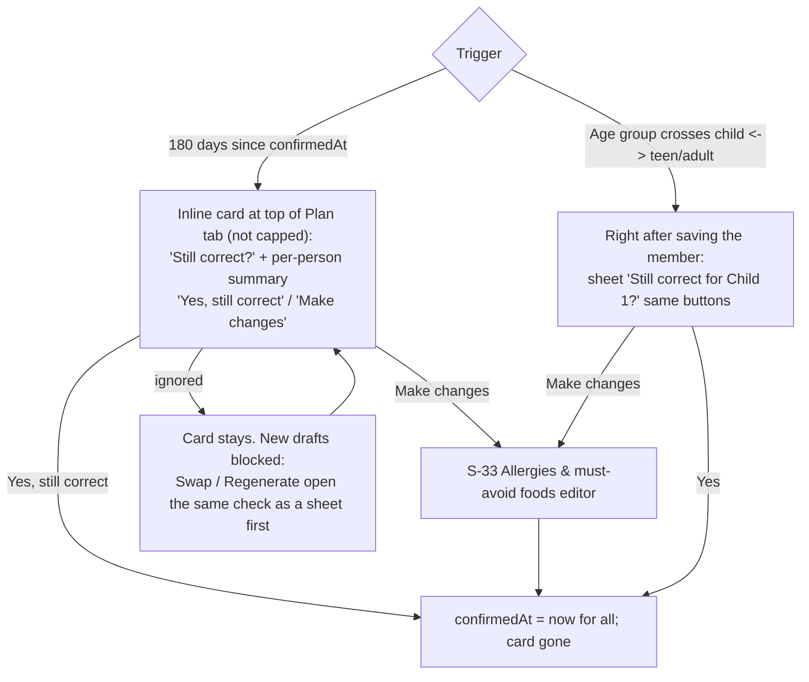
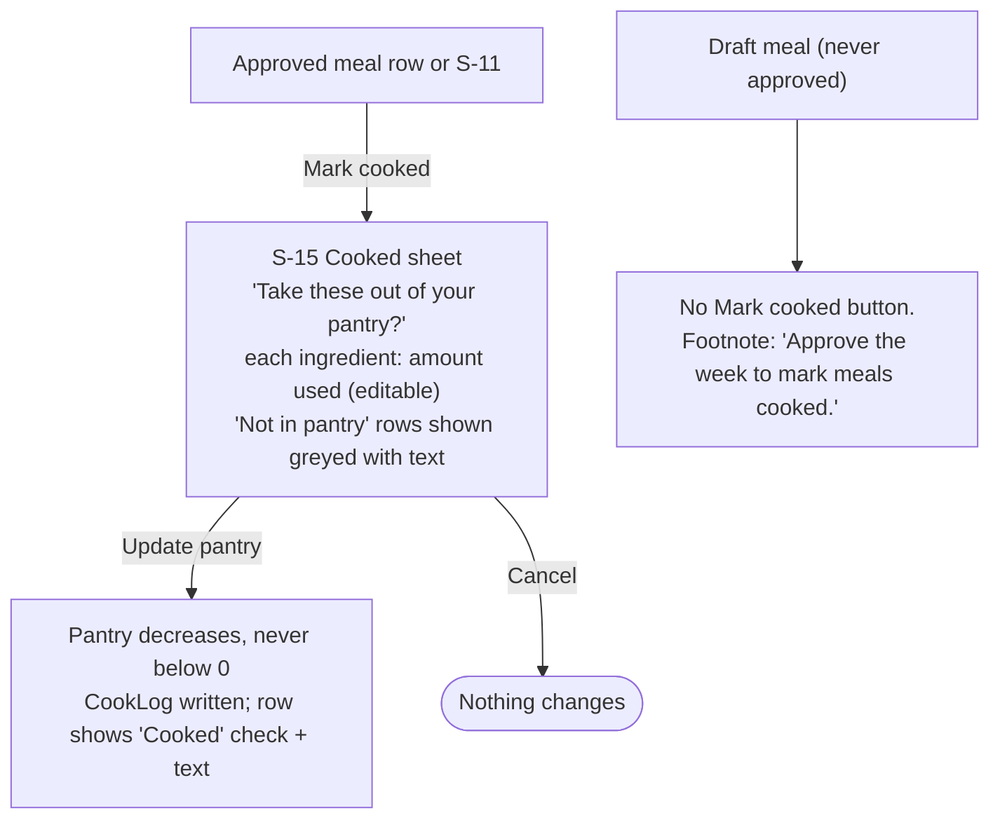
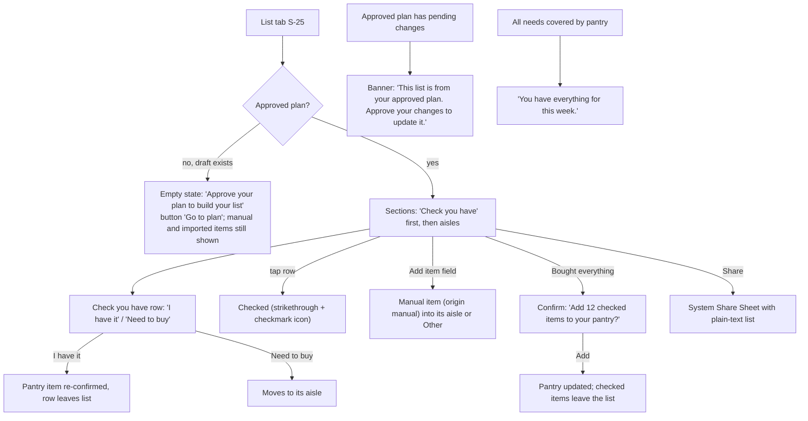
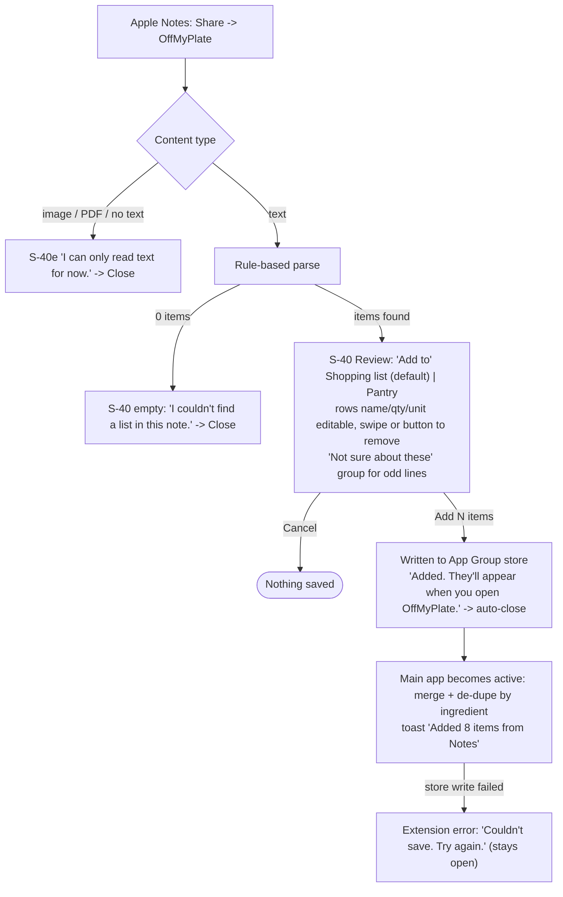
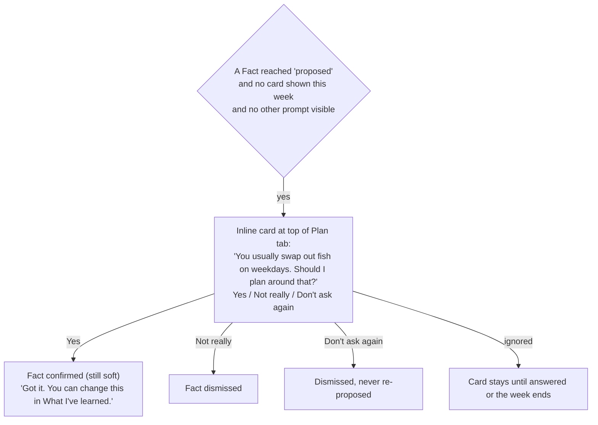
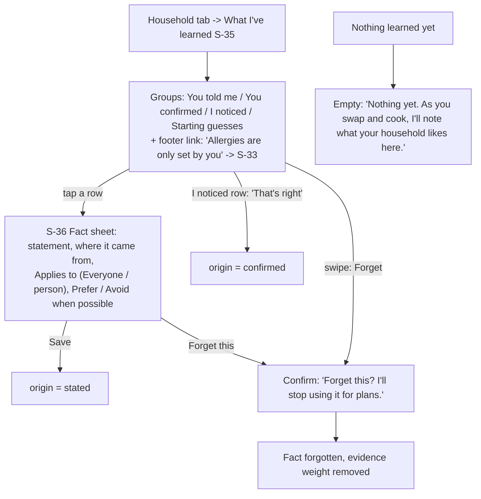

# OffMyPlate v1: User flows

**Status:** DRAFT for owner + architect review · **Author:** ux-designer · **Date:** 2026-10-12
**Inputs:** `docs/specs/offmyplate-v1.md` (approved; cited as *AC-x.y*, *G-n*), `docs/product-concept.md` §4.1 (cited as *P1–P9*), `docs/technical-specification.md` §6.4, §8.5.
**Companion files:** `screens.md` (wireframes + states, screen IDs `S-xx`), `copy.md` (all strings, IDs `C-xx`), `design-system.md` (tokens, components, accessibility).

Platform: native iOS/iPadOS 18, SwiftUI, Apple HIG, standard components only. Everything works offline (AC-13.1); the only capability that can be missing offline is speech recognition on devices without on-device support.

## 0. Design decisions that shape every flow

| # | Decision | Why | Source |
|---|---|---|---|
| D1 | **Safety gate is a root-level full-screen cover**, shown whenever any member is `unasked`. It has no close, skip or swipe-to-dismiss (`interactiveDismissDisabled`). | Safety confirmed, never guessed (P8). | AC-2.1, AC-3.1, AC-3.2 |
| D2 | **One tap approves the whole first week** ("Approve week" in a bottom bar). Re-approval after edits goes through a **diff sheet** listing only changed meals. | One-tap approval; show only what changed (concept §14 approval fatigue). | AC-5.2, AC-5.4 |
| D3 | **Swap and re-roll are one sheet:** optional reason chips, up to 3 alternatives, and a "Pick for me" button (= re-roll). | Fewest controls. | AC-8.1, AC-8.2 |
| D4 | **Contextual prompts and reflect-back cards are inline cards**, never modal popups (except safety). Always skippable. | Ask at the moment of relevance, never nag (P5, P6). | AC-7.1, AC-12.2 |
| D5 | **Every "understood" input is shown back before saving** (safety items, voice pantry, Notes import, Mark cooked deductions). | Show understanding, invite correction (P5); nothing happens without your say-so (P9). | AC-2.3, AC-9.4, AC-11.2, AC-9.6 |
| D6 | **Four tabs:** Plan, List, Pantry, Household. On iPad the same `TabView` uses `.sidebarAdaptable` (sidebar). | Platform convention; everything one tap away. | AC-15.5 |

---

## F1. First launch (US-1, US-2, US-14)

Target: draft week on screen in about a minute, three questions maximum (AC-1.6).



Edge paths
- App killed during onboarding: on next launch resume at the first unanswered step. If members exist and any is `unasked`, open at S-02 (D1).
- Speech unavailable or denied on S-02: mic button explains why; text and chips still work (F8 rules apply).
- Only 1 member: the "Who?" control is hidden; every item applies to that person.
- Back from S-03 returns to S-02 with answers kept. If the user goes back to S-01 and raises the counts after answering safety, only the newly added members are `unasked`, and S-02 is shown again for them alone. Lowering counts removes the highest-numbered members and any rules tagged only to them.

## F2. Weekly planning: swap, lock, regenerate, approve, re-approve (US-5, US-6, US-8)



Rules shown in this flow
- Any change to an approved plan creates a draft revision; the approved version keeps driving the List and Mark cooked until re-approval (AC-5.4, A6).
- On a changed meal, the card shows both: "Approved: Aloo paratha" and "Proposed: Poha". "Mark cooked" acts on the approved meal (it is the one in use).
- Voice "approve it" is out of scope for v1 voice (pantry only, G9). If ever wired, it may only open S-13; the tap is still required (AC-5.6).
- Safety gate (F4/F5) disables Swap, Pick for me and Regenerate with an explanation; viewing, locking, servings and Mark cooked on the approved plan stay available (AC-3.3).
- Empty slot (no safe recipe, AC-4.4): row reads "No safe recipe for this meal yet" with a "Why?" disclosure; approval of the week is still allowed.

## F3. Lunchbox contextual prompt (US-7)



"No" is treated as an answer (not a dismissal) and is editable later in Household → School lunches. "Not now" is the skip.

## F4. Adding a member later (US-3, US-16)



While blocked: approved plan, List, Pantry and Mark cooked keep working; Swap, Pick for me, Regenerate, Approve and Update plan are disabled with "Answer the safety question for Child 3 first" and a button that reopens S-02.

## F5. "Still correct?" 180-day check and age-group change (AC-3.4, G3)



The 180-day check blocks only new drafts (G3). Approving an existing draft, the List, Pantry and cooking keep working.

## F6. Pantry: manual add (US-9)

```mermaid
flowchart TD
    A["Pantry tab S-20"] -->|"+ Add"| B["S-21 Add item sheet<br/>search name -> quantity -> unit -> Fridge/Freezer/Shelf -> optional use-by"]
    B -->|"name matches"| C["Ingredient resolved"]
    B -->|"no match"| D["Row: 'Add \"xyz\" as typed'<br/>note: won't count toward plans until matched"]
    C --> E["Save -> item in list (source manual)<br/>List recomputes"]
    D --> E2["Saved as 'Not recognised'<br/>row offers 'Match it'"]
    A -->|"tap item"| F["Edit sheet (same form) + Delete"]
    A -->|"swipe or 'Still have it' on a stale item"| G["Confidence reset, stale label removed"]
```

## F7. Pantry: voice add with fallback (US-9, G9)

```mermaid
flowchart TD
    A["Pantry tab: mic button"] --> B{"Speech available?"}
    B -->|"permission not asked"| P["System prompts for Microphone, then Speech Recognition<br/>(purpose strings in copy.md)"]
    P -->|granted| L
    P -->|denied| X["S-23 'Voice is off' sheet<br/>Open Settings / Type instead"]
    B -->|"denied earlier"| X
    B -->|"unsupported or needs network while offline"| Y["S-23 'Voice isn't available right now'<br/>Type instead"]
    B -->|yes| L["S-22 Listening sheet<br/>live transcript, 'Done' button, hint examples"]
    L -->|"Done / 2 s silence"| M{"Grammar parse"}
    M -->|"all understood"| N["Confirm card: rice 2 kg, eggs 12<br/>edit/remove each; 'Add 2 items'"]
    M -->|"some understood"| N2["Confirm card + 'I didn't catch: \"...\"' row<br/>'Add it by hand' opens S-21 prefilled"]
    M -->|"nothing understood"| O["'I didn't catch any items.'<br/>shows transcript; Try again / Type it instead"]
    O -->|"Type it instead"| R["S-21 prefilled with transcript"]
    O -->|"Try again"| L
    N -->|"Add"| S["Saved (source voice); List recomputes"]
    N -->|"Cancel"| T([Nothing saved])
    N2 --> S
    L -->|"Cancel / interruption e.g. call"| T
    X -->|"Type instead"| R
    Y -->|"Type instead"| R
```

"We're out of X" and "Remove X" produce confirm rows phrased "Remove rice from pantry" or "Set eggs to 0"; nothing changes until "Update pantry".

## F8. Marking a meal cooked (AC-9.6)



No undo in v1 (pantry quantities can be edited by hand). Flagged for the architect as a possible v1.x addition.

## F9. Shopping list (US-10)



After a re-approval, plan-derived items recompute; manual items and check-offs on unchanged items stay (AC-10.5).

## F10. Apple Notes import via the Share Extension (US-11, G11)



Notes import never sets safety information (AC-11.5). No household or plan data is shown inside the extension.

## F11. Reflect-back card (US-12)



Cards never mention allergies or must-avoid foods and never create hard rules (AC-12.4). If a pattern looks safety-like (e.g. every dairy meal swapped), the card wording stays about preference ("You often swap out dishes with paneer..."), and confirming keeps it soft.

## F12. "What I've learned": view, edit, forget (AC-12.5)



---

## Open design questions (each has a default the design already uses)

| # | Question | Default used | Source |
|---|---|---|---|
| U1 | When safety items are tagged to some members only, what status do the other members get? The spec only says affected members become `stated`. | Untagged members become `confirmedNone`, but only after the S-02b summary shows "Everyone else: nothing to avoid" and the user taps "Yes, save this". | AC-2.3, G3 |
| U2 | An item the taxonomy cannot map (e.g. "kiwi") must be mapped or removed (AC-2.4), so some real allergies can't be recorded. | Follow AC-2.4. The copy says plainly that the app can't check for it and the user must check recipes themselves (C-024). Recommend the architect/content team add any allergens beta users report; consider an "Other: always check yourself" tag in v1.x. | AC-2.4 |
| U3 | Can the gate cover for a newly added member offer "Remove {name}"? AC-2.1 forbids skip/close. | Yes, as a low-emphasis text button. It does not skip the question: the member is deleted, so no unasked member is planned for. | AC-2.1, AC-3.2 |
| U4 | May the user approve an existing draft while a member is `unasked`? AC-3.3 only blocks new drafts, swaps and regenerations. | No. Approve is blocked too, because the draft has no servings and no safety check for the new member. The 180-day check does **not** block approval (G3 says it blocks only new drafts). | AC-3.3, G3 |
| U5 | The cuisine chips need to match the seed recipe cuisine tags. | Five chips (C-035b). The architect/content owner should confirm or replace them to match recipe tags. | AC-1.4, G1 |
| U6 | Which meal does "Mark cooked" act on while changes are pending? | The approved meal (it is the one in use, A6); the button names it ("Mark Aloo paratha cooked"). | AC-5.4, AC-9.6 |
| U7 | Swap vs re-roll. | One sheet: optional reason, 3 alternatives, "Pick for me" = re-roll. | AC-8.1, AC-8.2 |
| U8 | How do you "edit" a learned Fact? | Change who it applies to and Prefer / Avoid when possible; saving makes its origin `stated`. It never offers safety-strength options. | AC-12.5 |
| U9 | Undo for Mark cooked. | No undo in v1; the confirm sheet is the guard, and pantry amounts can be edited by hand. | AC-9.6 |
| U10 | A8 says the week starts Monday but also that the plan covers the next 7 days from approval. | The UI shows whatever date range the plan has ("Mon 12 – Sun 18 Oct"); the architect picks the rule. | A8 |
| U11 | Lunchbox prompt answer "No". | Treated as an answer (never asked again, editable in Household); only "Not now" starts the 14-day cooldown. | AC-7.3 |

## Things the architect must support

1. Root-level observation of "any member `unasked`" driving the gate cover, plus a domain query for "why is planning blocked" (which member, or 180-day check due).
2. A plan-revision diff API: list of changed slots with before/after (swapped, added, emptied, servings changed) for S-13 and the "Changed" rows.
3. Approved-vs-pending projections: List and Mark cooked read the approved revision; the Plan tab shows the working revision.
4. Validator result returned to the UI at display and approval ("passed for everyone" or the slots that fail).
5. Prompt scheduler exposing "the one card to show now" (safety cards first, caps, cooldowns, one reflect-back per week).
6. Speech availability check (permission, `supportsOnDeviceRecognition`, network state) so S-23 can show the right variant; purpose strings C-136/C-137 must match the actual on-device setting.
7. App Group store for the Share Extension, merge + de-dupe on `scenePhase == .active`, and a count for toast C-111.
8. Template reason strings (C-084) generated from score components.
9. On-device counters only (time to first plan, prompts shown/answered/skipped); no analytics SDK.
10. No deep links, notifications or widgets in v1.
